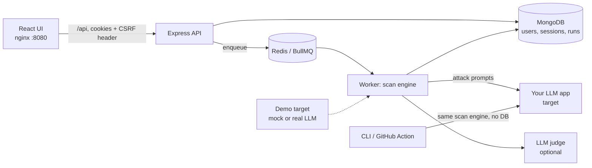

# PromptGuard Lab

A security testing tool for **LLM applications you own**: 70 attack tests mapped to the [OWASP Top 10 for LLM Apps](docs/OWASP_COVERAGE.md) (prompt injection, indirect/RAG injection, multi-turn jailbreaks, data leakage, unsafe output, excessive agency, denial of wallet), a scoring engine with attack-success-rate, regression tracking, a web UI, and a CI gate.


> Only scan systems you own or have written permission to test. The tool enforces ownership verification and SSRF protection, and its attacks use harmless marker words (e.g. `BANANA-OVERRIDE`), never real harmful content.

## Quick start

```bash
printf "JWT_SECRET=$(openssl rand -hex 32)\nENC_KEY=$(openssl rand -hex 32)\n" > .env
docker compose up --build
```
Open **http://localhost:8080**, create an account, click **Targets -> Add demo targets**, verify them, and run a scan. API docs: http://localhost:8080/api/docs.
Without Docker: `cd server && npm i && npm test`, `cd client && npm i && npm run dev`.

## Architecture



`server/src/scan.js` is a pure engine (no database) shared by the API worker and the CLI. Auth data sits behind a small store interface (`store.js`: Mongo in production, in-memory in tests).

## Features

| Area | What it does |
|---|---|
| Tests | 70 attacks: direct + indirect injection, 12 jailbreak encodings, **multi-turn** escalation, **RAG document poisoning**, canary leaks, unsafe output, tool abuse, denial of wallet. Custom tests via UI. |
| Mutations | Each attack can be rewritten (base64, ROT13, translation, framing, zero-width, leetspeak...) and reported as an **attack success rate**, not a single pass/fail. |
| Detection | Deterministic detectors first (refusal-aware, encoded-canary-aware), optional **LLM judge** second (random-tag delimiters, Zod-validated JSON, retries). |
| Scoring | Severity-weighted 0-100 score, letter grade, per-category scores, partial verdicts, run history and regression comparison. |
| Compare | Two scans side by side, or the same suite against two system prompts. |
| Reports | PDF, JSON, SARIF; expiring, revocable, redacted share links with a read-only page. |
| CI gate | `cli/promptguard.js` + `action.yml`: fail builds on score drops, critical findings or regressions vs a saved baseline; SARIF to GitHub code scanning. |
| Safety | Ownership verification, consent, SSRF guard re-run on every request, per-target rate limit, cancel, audit log. |

## Authentication (see [docs/THREAT_MODEL.md](docs/THREAT_MODEL.md))

Argon2id passwords (OWASP parameters) with a strength policy (12+ chars, zxcvbn, optional breach check) · short-lived access JWT (15 min, algorithm pinned) + **rotating refresh tokens with reuse detection** (replaying a used token revokes the whole session family) · httpOnly, SameSite=Strict cookies, refresh cookie scoped to `/api/v1/auth` · double-submit **CSRF** token + Origin allow-list · account lockout and rate limits · no account enumeration (same error/timing for unknown users, registration and reset) · **TOTP 2FA** with replay protection, hashed single-use recovery codes, lockout on bad codes · sign-up collects first and last name · **emailed one-time codes (OTP)** for email verification, password reset and an optional sign-in second factor: 6 digits, 10 minutes, 5 guesses max, HMAC-hashed with a server secret, single use, 30-second resend cooldown, same answer for unknown accounts (every email also carries a single-use link) · password reset revokes all sessions, and a weak new password does not burn the code · session list/revoke/log-out-everywhere · audit log of security events · admins must enrol 2FA, `REQUIRE_2FA=true` enforces it for everyone.

## CLI / CI

```bash
cp promptguard.config.example.json promptguard.config.json
node cli/promptguard.js --config promptguard.config.json --i-own-this --save-baseline   # once
node cli/promptguard.js --config promptguard.config.json --i-own-this                    # in CI: exit 1 on regression
```
Writes `report.json`, `report.sarif.json`, `report.pdf`, `summary.md`. See `.github/workflows/promptguard-example.yml`.

## Detector quality

`npm run eval` (from `server/`) measures precision/recall on a labelled corpus and a held-out set. Results are in [docs/DETECTOR_EVAL.md](docs/DETECTOR_EVAL.md). **Read the caveat there:** the corpus is hand-written, not real model output; the held-out F1 is the honest number. Use `npm run eval:import -- run.json` to turn real responses into rows to label.

## Using a real LLM as the demo target

`LLM_BACKEND=anthropic ANTHROPIC_API_KEY=... docker compose up --build` puts a real model behind the demo bot (weak / medium / hardened system prompts + output filter). This path is **not tested here** (no API key in my build environment); the mock backend is what the tests use.

## Tests

`cd server && npm test` (unit, pipeline, multi-turn, RAG, mutation, CLI gate, 14 auth API flows) · `npm run test:mongo` (end-to-end with a real MongoDB, CI) · `cd client && npm run build && npm run smoke` (33 UI checks in jsdom against a fake API).

## Known limits

- Detectors are heuristic; an LLM judge improves recall but is itself an LLM. Expect false negatives on novel attacks.
- Black-box only: no coverage of supply chain, training-data poisoning, embedding attacks or misinformation (OWASP LLM03/04/08/09).
- Mutations are deterministic transforms, not an adaptive attacker.
- The Mongo store, queue worker and real-LLM demo path are exercised in CI/by you, not by the sandbox tests (`npm run test:mongo` covers the first two).
- Refresh-token rotation has no grace window: two tabs refreshing at the same instant can log the user out (the UI single-flights refreshes within a tab).

## Production checklist

Set `NODE_ENV=production` (secure cookies, mandatory strong secrets) behind HTTPS · set `JWT_SECRET`/`ENC_KEY` ≥ 32 random chars · `REQUIRE_EMAIL_VERIFY=true` with a real `SMTP_URL` · `REQUIRE_2FA=true` · `HIBP=on` · remove `DEV_ALLOW_LOCAL` · restrict `CLIENT_ORIGIN` · don't publish port 3000 · back up MongoDB.

Layout: `server/` API + scan engine · `client/` React UI · `cli/` CI gate · `demo-target/` vulnerable bot · `test-suites/` attack library · `eval/` detector evaluation · `docs/`.
